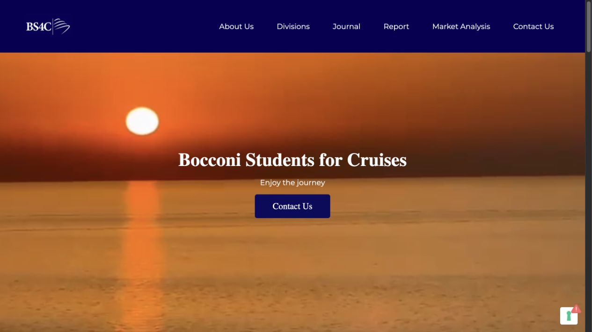

# BS4C · Bocconi Students for Cruises

Sito web realizzato per un’associazione universitaria dedicata al settore delle crociere.

**[Visita il sito attuale](https://www.bs4c.it/BS4C/)**

## Il progetto

BS4C riunisce in un unico sito la presentazione dell’associazione, le sue divisioni, il team e i contenuti editoriali: journal, report e analisi di mercato. La navigazione permette di raggiungere le pubblicazioni, i contatti e l’iscrizione alla newsletter.

## Il mio contributo

Mi chiamo **Flavio Petrone**. Ho seguito lo sviluppo del sito fino al rilascio del 7 settembre 2024 e collaborato con il team dell’associazione su aggiornamenti e miglioramenti. Il lavoro ha incluso l’adattamento mobile e interventi SEO, sulla base delle esigenze e dei riscontri del team.

## Tecnologie

- PHP per le pagine e le funzionalità lato server.
- MySQL, con accesso tramite PDO, per i dati applicativi.
- HTML, CSS e JavaScript per struttura, interfaccia e interazioni.

## Cosa contiene questo repository

Questa è una presentazione professionale di un lavoro realizzato per un’organizzazione reale. Contiene la descrizione del progetto e un’anteprima del sito; non contiene i sorgenti applicativi, le configurazioni del server, le credenziali o i dati del database.

Il sito di riferimento è quello collegato sopra. Questo repository non gestisce la pubblicazione del sito e non ne modifica contenuti, aspetto o funzionalità.

## Marchi e contenuti

Il nome BS4C, il marchio, le fotografie e i contenuti editoriali appartengono ai rispettivi titolari. L’anteprima è riportata per documentare il lavoro svolto; non viene concessa una licenza di riutilizzo di questi materiali.

---

[Profilo GitHub di Flavio Petrone](https://github.com/flavio-petrone)
